<div align="center">

# Pursuit

### The calm, focused CRM for your internship search.

[](https://pursuit.enoch.et)
[](https://nextjs.org)
[](https://react.dev)
[](https://www.typescriptlang.org)
[](https://supabase.com)
[](https://vercel.com)
[](https://github.com/Henok-Tekeba/pursuit)
[](https://github.com/Henok-Tekeba/pursuit/releases)

**Live app:** [pursuit.enoch.et](https://pursuit.enoch.et) · **Demo:** open the app and click **Open demo**

</div>

<p align="center">
  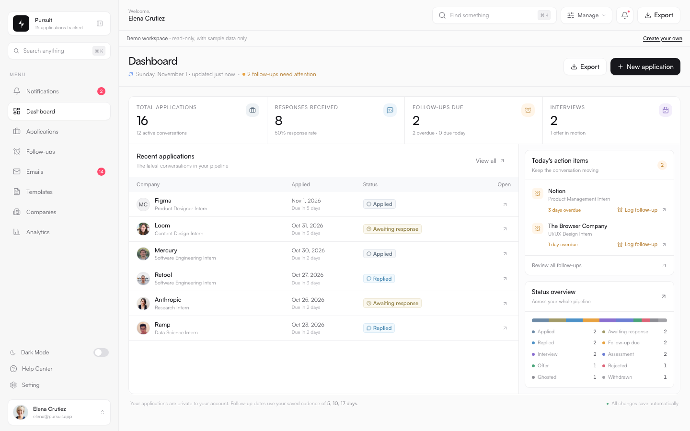
</p>

## Why Pursuit

Internship applications are not a spreadsheet problem. They are a relationship problem.

Pursuit keeps the entire search in one place: the companies, the people, the cold email you actually sent, the reply that came three weeks later, the follow-up you almost forgot, and the interview that came out of it.

No shared workspace. No noisy team features. Your search is yours.

## A day with Pursuit

1. **Verify once.** Continue with Google and finish a short profile. Your email is already verified.
2. **Capture the conversation.** Add the application, the company, the contact, and the exact first email you sent.
3. **Follow the cadence.** Pursuit suggests the next follow-up based on your saved intervals.
4. **Let the timeline do the remembering.** Replies, interviews, assessments, offers, rejections, and notes stay attached to the application.
5. **See the whole search.** Use analytics to find what is converting, then export everything whenever you want.

## What's inside

- **Google-verified signup** — new accounts start with Google, then finish a short onboarding profile. No SMTP provider to maintain just to create an account.
- **Private workspaces** — every application, email, company, template, and note is scoped to the signed-in user.
- **Dashboard** — pipeline totals, response rate, interviews, follow-ups due, recent applications, today's action items, and status mix.
- **Application management** — create, edit, view, delete, search, filter, sort, paginate, bulk-update, and bulk-delete.
- **Conversation timeline** — initial email, follow-ups, replies, interview and assessment invitations, offers, rejections, status changes, scheduled follow-ups, and notes. Emails are append-only.
- **Follow-up engine** — days since application, days since last contact, overdue state, and configurable cadence (defaults: days 5, 10, and 17).
- **Email archive and templates** — preserve the subject and body of every email; reuse cold-email, follow-up, and reply templates with placeholders.
- **Companies** — company-level rollups, notes, response rates, and related applications.
- **Analytics** — response rate, interview conversion, offer rate, average response time, follow-up effectiveness, status and method breakdowns, monthly activity.
- **CSV export** — export the full application history at any time.
- **Onboarding and product tour** — a six-step guided tour with Next, Back, and Skip, plus a replayable tour from Help Center.
- **Responsive and dark mode** — full-viewport desktop workspace, mobile navigation, and a complete dark theme.

## Design principles

- **Calm over busy.** The dashboard should answer “what needs me today?” before it shows anything else.
- **The conversation is the record.** The original email, the reply, and the note belong together.
- **Private by default.** Every query is user-scoped. There is no shared workspace.
- **No fake urgency.** Nothing is auto-ghosted. You decide when a conversation is over.
- **Fast by default.** Server-rendered pages, small client islands, and no unnecessary loading states.

## Product screens

| Applications | Analytics |
| --- | --- |
| 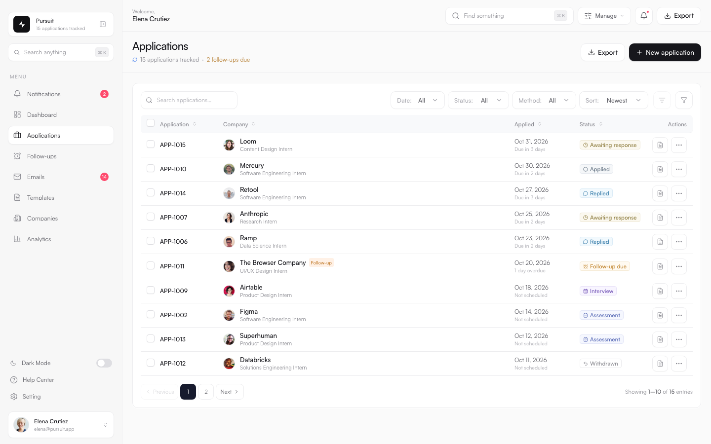 | 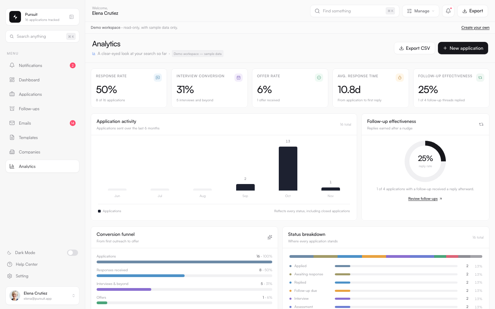 |

<p align="center">
  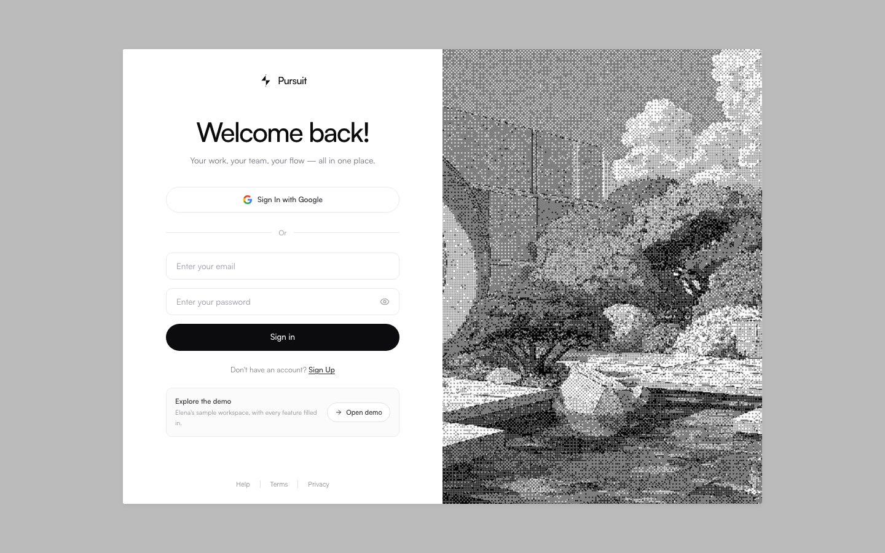
</p>

### More screens

| Follow-ups | Templates |
| --- | --- |
| 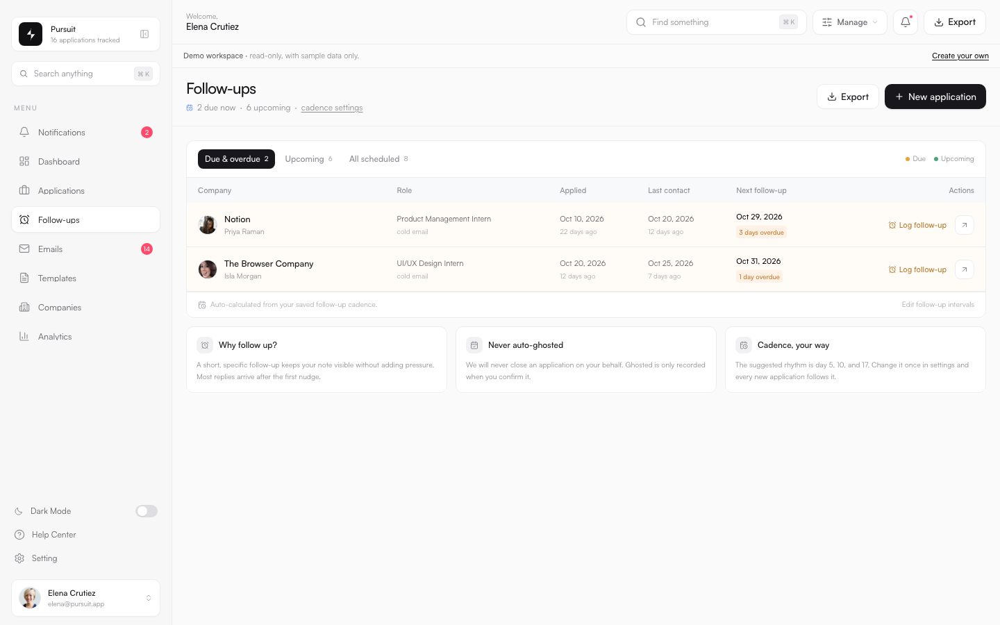 | 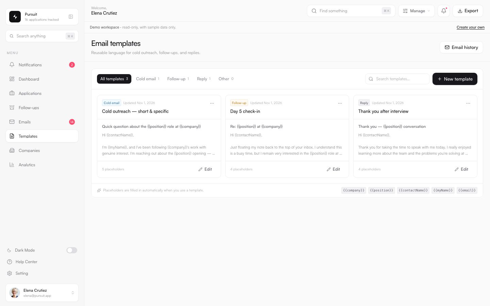 |

| Companies | Emails |
| --- | --- |
| 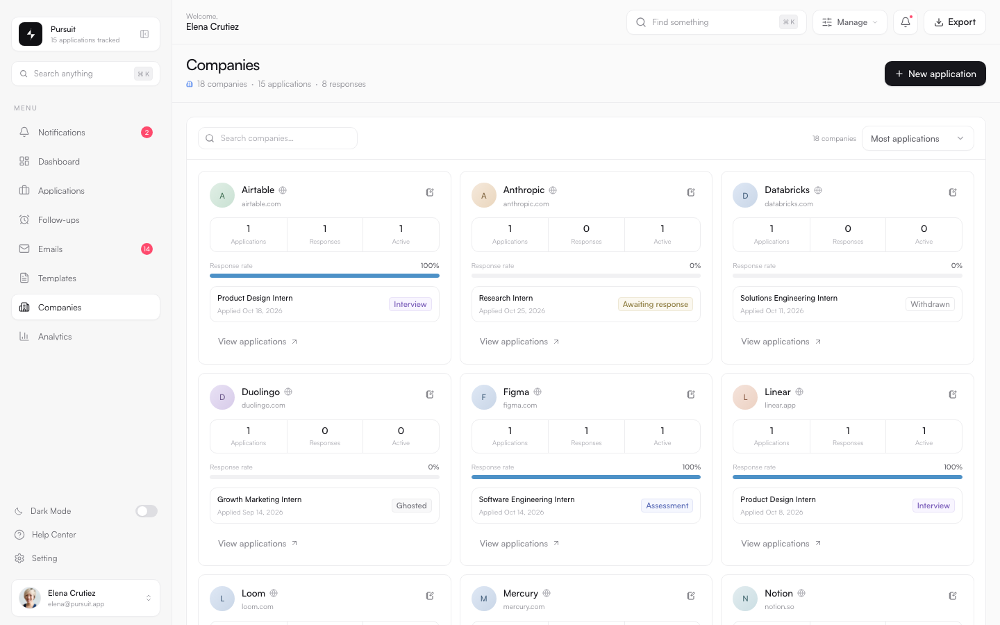 | 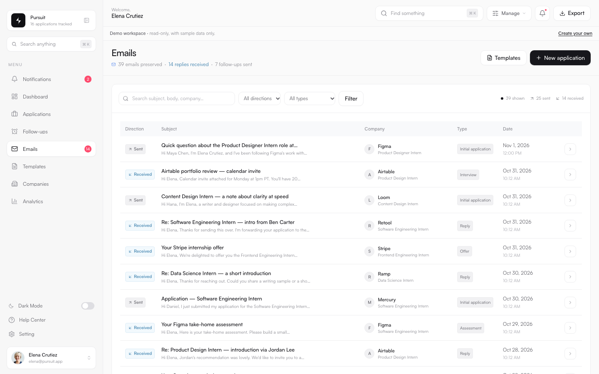 |

| Settings | Guided tour |
| --- | --- |
| 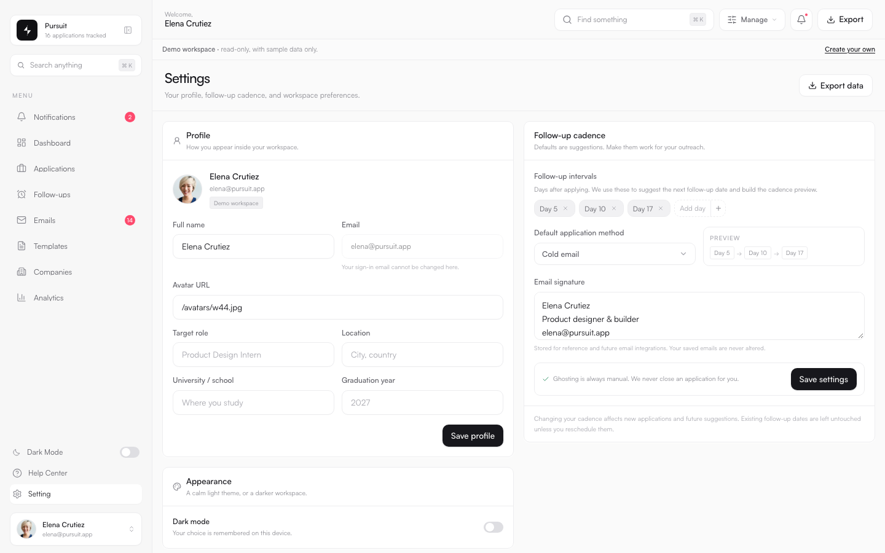 | 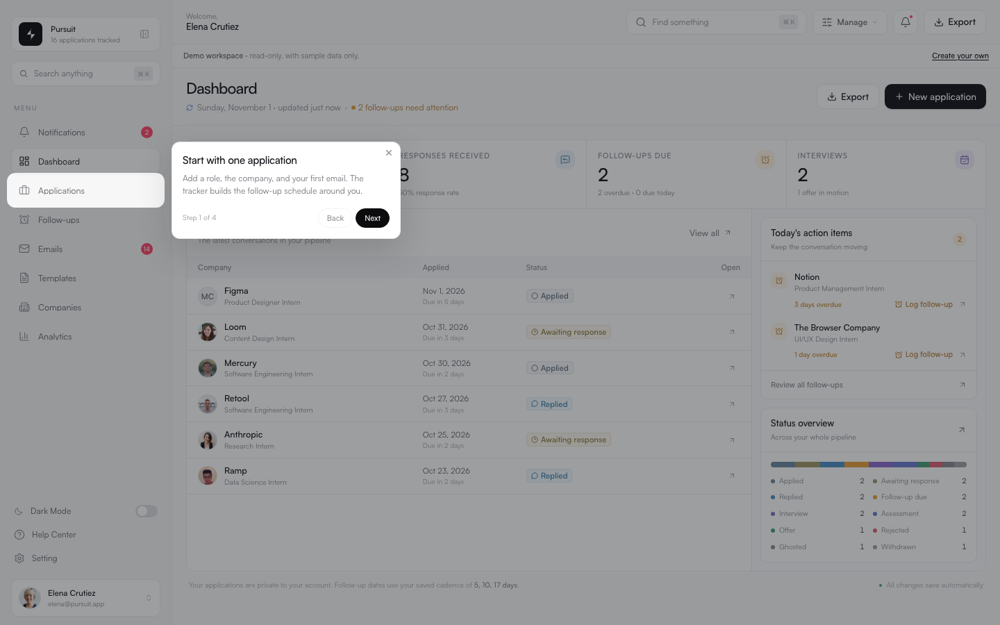 |

<p align="center">
  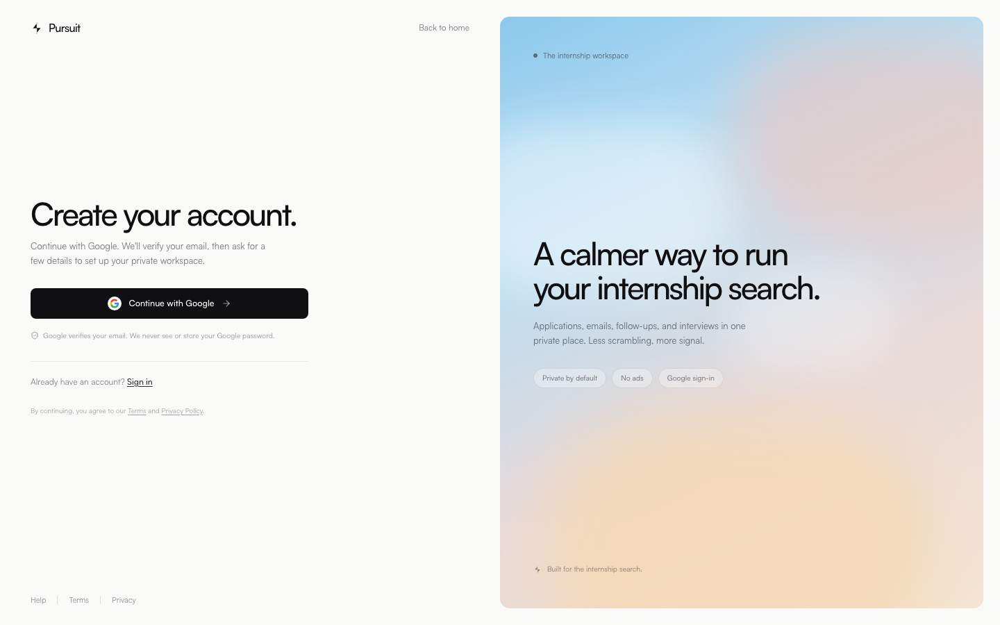
</p>

## Auth model

Pursuit uses Google as the account-creation path. Google has already verified the email before the account is created, so there is no separate magic-link or OTP email pipeline to operate.

```text
/signup
  └─ Google OAuth via Supabase Auth
       └─ /auth/callback
            ├─ existing app user → /dashboard
            └─ new user → /onboarding
                         └─ profile + optional password
                              └─ /dashboard?welcome=1 → product tour
```

- **New accounts** are Google-only. The onboarding step collects name, target role, school, graduation year, location, and an optional password.
- **Existing email/password accounts** remain supported at `/login`.
- **Demo access** is a read-only one-click session on the login screen. It is clearly marked as sample data and does not expose a password credential.
- **Sessions** use signed, HTTP-only cookies. Passwords are hashed with scrypt.
- **Data access** is enforced in the application layer: every read and mutation is filtered by the authenticated user ID.

There is no Supabase service-role key in the application. Supabase is used for Postgres and, through the public client key, Google OAuth.

## Architecture

```text
Browser
  │
  ▼
Next.js 15 App Router
  ├─ Server Components + Server Actions
  ├─ Auth: Google / Supabase Auth + app sessions
  ├─ Drizzle ORM
  │    ├─ Production: Supabase Postgres
  │    └─ Local: embedded PGlite
  ├─ Product tour (driver.js)
  └─ Date/time rendering in a fixed app timezone
```

The application is intentionally a modular monolith. Route handlers and server actions own mutations; Drizzle owns the data access; the UI is built from small, composable components.

## Stack

| Layer | Choice |
| --- | --- |
| Framework | Next.js 15 App Router, React 19, TypeScript |
| Styling | Tailwind CSS, Radix primitives, Satoshi |
| Data | Drizzle ORM + PostgreSQL |
| Production database | Supabase Postgres |
| Local database | Embedded PGlite — zero external setup |
| Auth | Supabase Auth for Google; app-owned sessions and credentials |
| Product tour | driver.js |
| Deployment | Vercel |
| Domain | Cloudflare DNS → `pursuit.enoch.et` |

## Run locally

Requirements: Node.js 20+ and pnpm.

```bash
pnpm install
cp .env.example .env.local

# Generate the session signer.
openssl rand -base64 32
# Put the output in SESSION_SECRET.

pnpm dev
```

Open **http://localhost:3000**.

Without a database URL, Pursuit runs on an embedded PostgreSQL-compatible database in `.data/pglite`, applies the Drizzle migrations, and seeds Elena's demo workspace. No Docker or cloud account is required.

To use Google signup locally, add the Supabase public keys and register `http://localhost:3000/auth/callback` in Supabase Auth → URL Configuration.

### Demo workspace

On the login screen, click **Open demo**. Elena's workspace is read-only and contains 15 sample applications, emails, replies, follow-ups, notes, and analytics. The demo is completely separate from your own account.

## Environment variables

```bash
# Application
APP_URL=http://localhost:3000
SESSION_SECRET=generate-a-long-random-value
NEXT_PUBLIC_APP_TIMEZONE=Africa/Addis_Ababa

# Demo workspace
SEED_DEMO=true
DEMO_LOGIN_ENABLED=true

# Production database (Supabase Postgres recommended)
DATABASE_URL=postgresql://...

# Google signup through Supabase Auth
NEXT_PUBLIC_SUPABASE_URL=https://<project-ref>.supabase.co
NEXT_PUBLIC_SUPABASE_ANON_KEY=<publishable-key>
```

| Variable | Required | Purpose |
| --- | --- | --- |
| `APP_URL` | Production | Canonical URL used for OAuth callbacks and absolute links |
| `SESSION_SECRET` | Yes | Signs session cookies. Rotating it signs everyone out |
| `DATABASE_URL` | Production | Postgres connection string |
| `NEXT_PUBLIC_SUPABASE_URL` | For Google signup | Supabase project URL |
| `NEXT_PUBLIC_SUPABASE_ANON_KEY` | For Google signup | Supabase publishable key |
| `NEXT_PUBLIC_APP_TIMEZONE` | Recommended | One display timezone for server and browser rendering |
| `SEED_DEMO` | No | Enables the local demo workspace seed |
| `DEMO_LOGIN_ENABLED` | No | Shows/hides the **Open demo** shortcut |

Never commit `.env.local` or a production secret.

## Database

```bash
# Apply Drizzle migrations to the configured Postgres database
DATABASE_URL="postgresql://..." pnpm db:migrate

# Seed the demo user
DATABASE_URL="postgresql://..." pnpm db:seed
```

Migrations live in `drizzle/`. For a brand-new Supabase project, `supabase/schema.sql` is an alternative one-file schema for the SQL editor. Use one path or the other, never both.

### Core tables

| Table | Responsibility |
| --- | --- |
| `users` | Account, profile, onboarding, and demo marker |
| `auth_tokens` | Legacy local auth token storage |
| `companies` | User-scoped company records and notes |
| `applications` | Role, contact, method, status, dates, and notes |
| `email_interactions` | Append-only sent/received emails |
| `activities` | Chronological application timeline |
| `templates` | Reusable email content |
| `settings` | Follow-up cadence, default method, signature |

## Google OAuth setup

1. Create a Google Cloud OAuth client of type **Web application**.
2. Add the Supabase callback as an authorized redirect URI:

```text
https://<project-ref>.supabase.co/auth/v1/callback
```

3. Paste the Client ID and Client Secret into **Supabase → Authentication → Providers → Google**.
4. In **Supabase → Authentication → URL Configuration**, set:

```text
Site URL: https://pursuit.enoch.et
Redirect URLs:
  https://pursuit.enoch.et/auth/callback
  http://localhost:3000/auth/callback
```

Google Cloud's redirect URI stays pointed at Supabase. The app only needs the Supabase public URL and publishable key.

When publishing the OAuth consent screen, use:

```text
App name: Pursuit
Support email: tekebahenok6@gmail.com
Privacy policy: https://pursuit.enoch.et/privacy
Terms of service: https://pursuit.enoch.et/terms
```

## Testing

With the app running on port 3001:

```bash
pnpm test:flows
pnpm test:extended
```

- `test:flows` exercises the read-only demo workspace: sign-in, read-only state, search, page rendering, and CSV export.
- `test:extended` creates a temporary verified QA account directly in the database, exercises the empty workspace, templates, settings, bulk actions, notes, scheduling, data isolation, password changing, password sign-in, the demo shortcut, and sign-out, then cleans up the account.

For a server on a different port:

```bash
TEST_BASE_URL=http://localhost:3000 pnpm test:flows
TEST_BASE_URL=http://localhost:3000 pnpm test:extended
```

## Deployment

Production runs on Vercel with Supabase Postgres and a Cloudflare-managed custom domain.

1. Create the Vercel project and add the production environment variables.
2. Apply migrations to the production database once.
3. Add the custom domain in Vercel.
4. In Cloudflare, point the subdomain at Vercel with a DNS-only CNAME:

```text
Type: CNAME
Name: pursuit
Target: <vercel-provided-cname>
Proxy: DNS only
```

5. Configure Supabase URL Configuration and Google OAuth as above.
6. Deploy:

```bash
vercel deploy --prod
```

The current production deployment is [pursuit.enoch.et](https://pursuit.enoch.et).

## Security notes

- Session cookies are HTTP-only, same-site, and signed with `SESSION_SECRET`.
- Passwords use scrypt with per-user salts.
- Google identity is verified by Google and handled through Supabase Auth.
- The application uses the Supabase publishable key, never a service-role key.
- All application data access is scoped to the authenticated user.
- Demo data is clearly separated and no production credentials are stored in source.
- Report a security issue privately rather than opening a public issue.

## Project structure

```text
app/
  (auth)/              Login, signup, auth shell
  (app)/               Authenticated application shell and pages
  actions/              Server actions for auth, onboarding, applications
  api/                  Health, export, search, OAuth routes
  auth/callback/        Supabase OAuth / email callback
  onboarding/           Profile completion after verification
components/
  app-shell/            Sidebar, topbar, search, help, notifications
  auth/                 Login, Google signup, onboarding form
  applications/         Application list, detail, email/timeline panels
  dashboard/            Metrics, recent applications, actions
  onboarding/           Product tour
  settings/             Profile, password, follow-up settings
lib/
  auth/                 Sessions, password hashing, demo, social providers
  db/                   Drizzle schema, migrations, demo seed
  queries/              User-scoped data reads
  supabase/             Supabase server client
drizzle/                SQL migrations
docs/screenshots/       README screenshots
scripts/                Flow tests and migrations
supabase/schema.sql     Fresh-database schema for SQL editor
```

## Roadmap

- Email reminders and calendar sync
- Resume and attachment storage
- Shared read-only workspaces for mentors
- More OAuth providers

## Status

Pursuit v1.0.0 is live and actively used for a real internship search. The priority is a calm, reliable workflow over feature sprawl.


## Repository

Source: [github.com/Henok-Tekeba/pursuit](https://github.com/Henok-Tekeba/pursuit)

Legal: [Privacy](https://pursuit.enoch.et/privacy) · [Terms](https://pursuit.enoch.et/terms)

## License

This repository is public for portfolio and demonstration purposes. All rights reserved. No license is granted to deploy, resell, or redistribute the application or Pursuit branding without permission.
